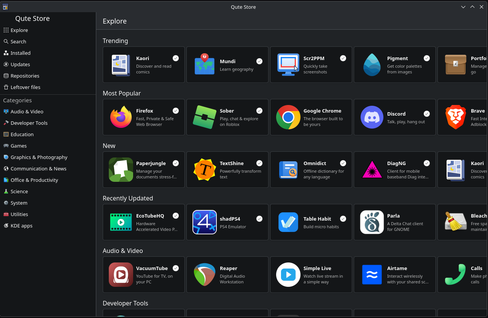
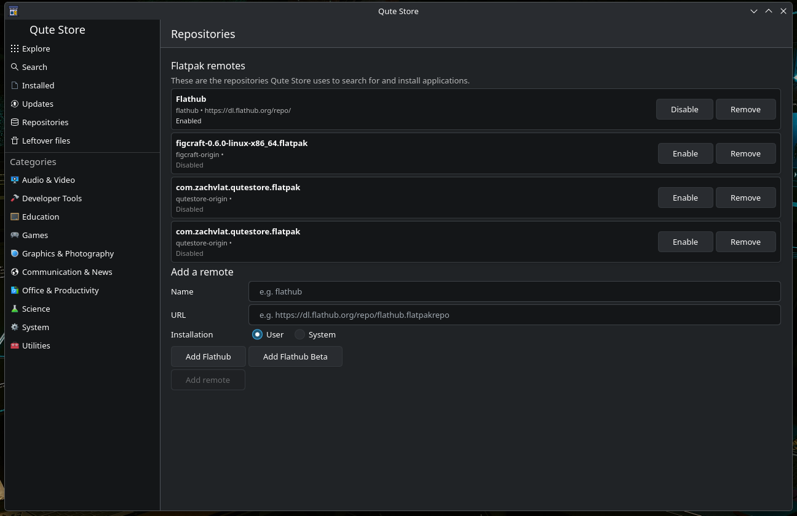
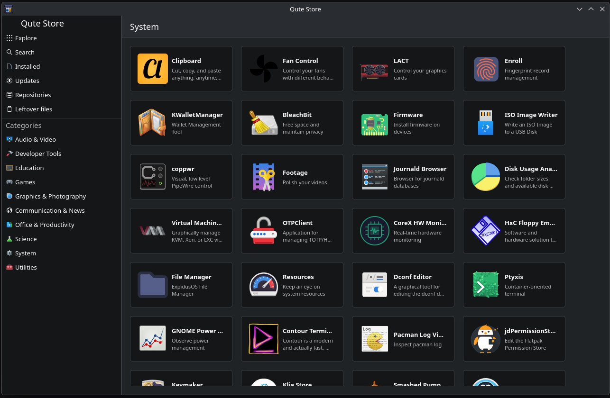

#  Qute Store

A work-in-progress **native KDE/Qt (Kirigami) port of a Flatpak store**, borrowing its
design and per-feature behavior from [Bazaar](https://github.com/kolunmi/bazaar).

## Building Flatpak

```sh
git clone https://github.com/zachvlat/qutestore
cd qutestore
./setup-flatpak-build.sh
```

## Screenshots



